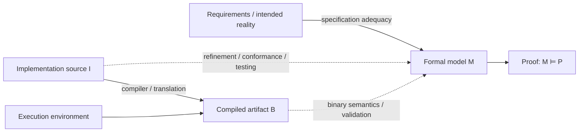
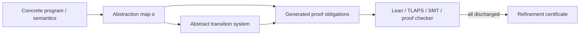
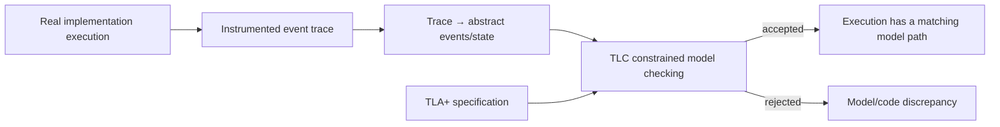
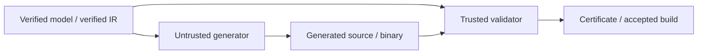
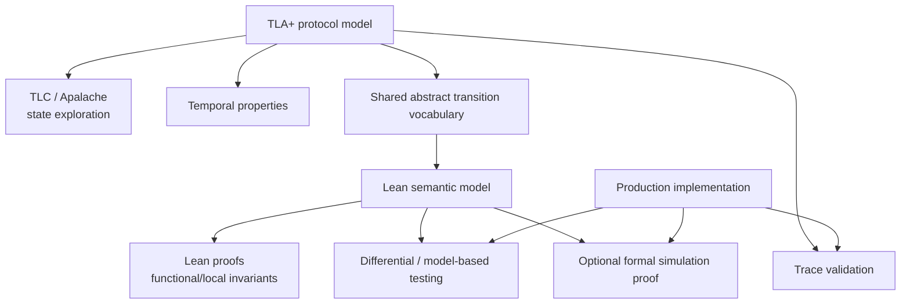
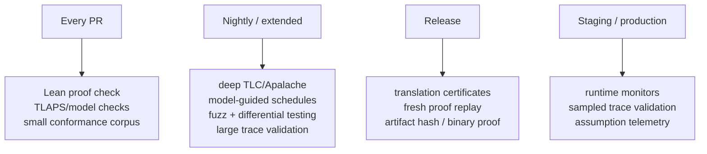

# Connecting Formal Models and Proofs to Production Implementations

## Executive summary

The central problem is not proving a TLA+ model or a Lean theorem. It is establishing a defensible relationship between that proved object and the software that actually runs.

Suppose a formal model `\(M\)` has a proved property `\(P\)`:

```latex
\[
M \models P
\]
```

That fact says nothing, by itself, about an implementation `\(I\)`. The missing proposition is some form of:

```latex
\[
I \sqsubseteq M
\]
```

where `\(\sqsubseteq\)` might mean trace refinement, forward simulation, observational equivalence, bisimulation, semantic preservation, or another formally defined conformance relation. If the relation is strong enough and `\(P\)` is preserved by it, then one can conclude:

```latex
\[
I \models P
\]
```

This seemingly obvious step is the **model–implementation gap**, and virtually every technique surveyed here is a different way of addressing it. Abadi and Lamport's foundational refinement work formalizes exactly this idea: a lower-level specification implements a higher-level one when its behaviors map to allowed higher-level behaviors, potentially after adding history, prophecy, or stuttering variables. citeturn13view0turn13view1

The key conclusion of the literature is that there is no single "connect the proof to the code" technique. There is an **assurance ladder**:

1. **Traceability and model-derived tests** establish correspondence empirically.
2. **Differential/model-based testing and trace validation** establish conformance over many selected executions.
3. **Runtime verification** establishes or enforces conformance for executions actually observed.
4. **Translation validation** establishes a semantic relationship for each generated or compiled artifact.
5. **Deductive refinement proofs** establish the relationship for *all* executions admitted by formalized implementation semantics.
6. **Verified extraction/compilation** carries source-level theorems through a formally proved compilation chain.
7. **Machine-code or binary-level verification** reasons about the artifact closest to deployment, shrinking the remaining gap to formalized ISA/OS semantics and environmental assumptions.

The important distinction is therefore not "formal versus informal." It is **what proposition has actually been established, over what executions, and with what trusted computing base**.

TLA+ and Lean occupy different—and complementary—places on this ladder. TLA+ is unusually strong at abstract concurrent/distributed state machines, nondeterminism, temporal behavior, stuttering, model checking, and refinement between specifications. Recent work on trace validation, CCF, PGo, TraceLink, Choreographic PlusCal, Mocket, and OmniLink has substantially improved its implementation connection. Nevertheless, ordinary TLA+ usage still normally proves the **design**, not arbitrary production source code. citeturn13view5turn16view0turn15view4turn18search6turn18academia24

Lean is much better suited to stating and machine-checking a semantic theorem directly about an executable function or a formal semantics of source code. An executable Lean model can also serve as a reference oracle against another implementation, as AWS did with Cedar: Lean contains the executable formal model and proofs; Rust is the production implementation; differential random testing sends millions of generated inputs through both. That is excellent engineering evidence, but the authors correctly describe the differential-testing leg as increasing confidence rather than proving Rust equivalent to Lean. citeturn16view3turn16view4

For stronger Lean-to-production connections, a particularly important development is **Aeneas**, which translates Rust into a pure functional representation suitable for Lean verification. Recent work reports its use on production cryptographic Rust, shifting the proof target from a separately handwritten model toward a representation extracted from the implementation itself. citeturn13view12turn13view13

The most compelling practical strategy for an existing codebase is consequently **layered assurance**, rather than immediately attempting a seL4-style proof of everything:

> **TLA+ for behavioral design and temporal/concurrent properties → trace validation and model-guided tests against real executions → executable Lean models and differential testing for deterministic semantic cores → formal simulation/refinement proofs for selected high-value components → verified/validated compilation or binary verification where the risk warrants it.**

Each layer catches a different class of disconnect, and—critically—the layers can share the same abstraction mapping, event vocabulary, and property identifiers.

The recent Anthropic/Theorem work is especially relevant because it takes the opposite approach to most model-to-code workflows: rather than laboriously prove that source implements a separately proved high-level model, it creates the theorem **over the compiled binary itself**. The reported experiment proves no-crash properties for 239 entry points in 123 OSS-Fuzz libraries directly over compiled RISC-V instructions, with Rocq checking proofs against formal RISC-V/Linux semantics. This eliminates an enormous portion of the traditional model/source/compiler gap, although Anthropic explicitly emphasizes that the result remains conditional on the theorem statement, formal machine/OS models, checker, and environmental assumptions. citeturn16view6turn16view7turn16view8

The uncomfortable but useful takeaway is:

> **A proved model is not evidence that production code is correct until there is evidence about the arrow between them.**

That arrow is the real subject of this report.

## The bridge from a proved model to running code

A useful way to reason about the problem is as an assurance chain rather than a single proof.



There are four conceptually separate questions:

**Is the property right?** A theorem can prove the wrong theorem perfectly. Anthropic makes this point explicitly: formal verification cannot establish that the formal specification correctly captures the real-world requirement. citeturn16view8

**Does the model have the property?** This is the part TLC, TLAPS, Lean, Rocq, Isabelle, Dafny, and similar tools are good at.

**Does the implementation implement the model?** This is the troublesome arrow. Trace validation, testing, refinement proofs, bisimulation, code extraction, proof-producing transformations, and translation validation attack this question.

**Does the deployed artifact correspond to the verified implementation?** Ordinary source-level verification can leave compilers, runtimes, foreign-function interfaces, assembly, operating systems, and hardware in the trusted computing base. CompCert reduces the compiler part of this gap by proving semantic equivalence between CompCert C and generated assembly; CakeML similarly provides a proven-correct compiler and runtime. citeturn15view3turn13view9

### Refinement is the canonical mathematical connection

The classic state-machine formulation is roughly:

- `\(A\)`: abstract state
- `\(C\)`: concrete implementation state
- `\(R(C,A)\)`: refinement/abstraction relation

The essential safety proof obligations are then:

```latex
\[
ConcreteInit(c) \Rightarrow \exists a.\ AbstractInit(a) \land R(c,a)
\]
```

and

```latex
\[
R(c,a)\land ConcreteStep(c,c')
\Rightarrow
\exists a'.\big(AbstractStep(a,a') \lor a'=a\big)\land R(c',a')
\]
```

The `\(a'=a\)` case represents an implementation step that is invisible at the abstraction level—a **stuttering step**, central to TLA-style refinement. Abadi and Lamport showed that, under appropriate conditions, refinement mappings are complete when suitable auxiliary variables may be added; Lamport and Merz subsequently gave practical TLA+ rules for history, prophecy, and stuttering variables. citeturn13view0turn13view1

For liveness, safety simulation is not enough. A concrete implementation could refine every abstract step while internally spinning forever. Additional obligations therefore concern progress, divergence, fairness, and preservation of enabled abstract behavior. This is one reason liveness refinement is significantly harder than invariant preservation. IronFleet is noteworthy precisely because it combines TLA-style state-machine refinement with program verification to establish both safety and liveness of executable distributed systems. citeturn15view5

Systems such as Event-B make these obligations explicit and tool-generated: refinement produces obligations for **guard strengthening**, **action simulation**, preservation of variables, feasibility, invariants, and variants/progress. Why3 illustrates the more general deductive-verification architecture in which source annotations are transformed into verification conditions and handed to automated or interactive provers. citeturn17search2turn17search3turn17search19

That architecture is worth stealing even when the formalism is TLA+ or Lean:



Instead of asking developers to remember that "function `advance()` corresponds to action `Commit`", encode that relationship once and generate obligations from it.

### Simulation versus bisimulation

A **forward simulation** is usually the right relation for an implementation of an abstract TLA+ specification. It permits the abstract model to be more nondeterministic than the implementation and permits internal concrete steps to become stutters.

**Bisimulation** requires matching behavior in both directions. It is consequently much stronger and often inappropriate for deliberately abstract specifications: one normally does *not* require production code to exhibit every nondeterministic choice that the abstract model permits.

Bisimulation is more natural for transformations intended to preserve complete observable semantics—for example, compiler passes, protocol encodings, or translations between equivalent intermediate representations. CompCert's semantic-preservation proofs and translation-validation literature occupy this neighborhood, though the exact relations are tailored to language semantics rather than simply applying textbook strong bisimulation. citeturn15view3turn13view11

### The trusted computing base matters as much as the proof

A useful review question for any purported verification is:

> **What must I trust before this theorem says anything about the binary I deploy?**

For ordinary model checking plus handwritten implementation, the answer includes the entire informal model/code translation.

For a kernel-checked Lean theorem, the logical TCB can be small, but that does **not automatically mean compiled Lean execution is covered by the same tiny TCB**. Lean's current reference documentation explicitly notes that native proof computation depends on the compiler and `@[implemented_by]` replacements; those replacements are assumptions of semantic equivalence, and externally replayed proof checking cannot independently validate them. Lean therefore recommends stronger external proof checking in CI where appropriate. citeturn15view1turn15view2

This distinction is easy to miss:

> **"Lean proved the function" and "the native code emitted for this function is proved equivalent to that logical function" are different claims.**

Verified compilation, verified extraction, translation validation, or target-level verification is what connects those claims. Work on verified Rocq-to-OCaml extraction explicitly identifies ordinary extraction as part of the trusted computing base and develops a correctness theorem for the extraction pipeline. citeturn17search14turn17search22

## Comparative survey of implementation-connection approaches

The assurance labels below mean:

**Empirical** — evidence from selected executions, not universal.

**Per-execution formal** — rigorous result for the particular observed execution.

**Universal relative to semantics** — theorem covers all behaviors of a formalized implementation semantics under stated assumptions.

**End-to-end high assurance** — theorem is carried substantially toward source/compiler/machine artifact, with an explicitly reduced TCB.

| Approach                                             | Applicable to TLA+/Lean/both                                         | Assurance level                                               | Effort                                  | Pros/cons                                                                                                                                                                                                         | Key tools                                                                                             |
| ---------------------------------------------------- | -------------------------------------------------------------------- | ------------------------------------------------------------- | --------------------------------------- | ----------------------------------------------------------------------------------------------------------------------------------------------------------------------------------------------------------------- | ----------------------------------------------------------------------------------------------------- |
| Informal traceability / property-to-code mapping     | Both                                                                 | Low                                                           | Low                                     | Cheap and useful organizationally; does not establish semantic correspondence and goes stale easily                                                                                                               | Requirements IDs, ADRs, code annotations, generated traceability matrices                             |
| Model-based / model-check-guided testing             | Both                                                                 | Empirical                                                     | Low–medium                              | Excellent retrofit path; explores behaviors derived from model; can reproduce model-checker counterexamples in real system. Cannot establish correctness of untested executions                                   | TLC/Apalache-derived tests, Mocket, QuickCheck/Hypothesis-style frameworks, fuzzers                   |
| Differential testing against executable formal model | Especially Lean; possible with executable TLA-derived oracle         | Empirical, often strong                                       | Medium                                  | Very high leverage; production code remains idiomatic; excellent CI fit. Equality is sampled, not proved                                                                                                          | Lean executable model + cargo-fuzz in Cedar; generated model interpreters                             |
| TLA+ trace validation / conformance checking         | TLA+                                                                 | Per-execution formal, overall empirical                       | Medium                                  | Checks whether real executions can be explained by spec; retrofits to existing languages; excellent CI integration. Instrumentation and abstraction choice are trusted; incomplete traces may be underconstrained | TLC trace validation, CCF, etcd, TraceLink, OmniLink                                                  |
| Runtime verification / generated monitors            | Both                                                                 | Per-execution formal; enforcement can prevent some violations | Medium                                  | Observes real production behavior; can detect drift continuously. Usually covers safety/prefix properties rather than universal future behavior; instrumentation/monitor semantics matter                         | Choreographic PlusCal, temporal monitors, custom Lean/TLA-derived monitors                            |
| Code generation from verified model                  | TLA+ family; Lean can itself be executable                           | Medium–high, depending on generator trust                     | Medium–high                             | Eliminates handwritten transcription; preserves architectural link. Unverified generator, runtime, FFI, and environment remain in TCB                                                                             | PGo/Modular PlusCal; Lean compiler; proof-oriented DSLs                                               |
| Translation validation                               | Both / language-independent                                          | High per artifact                                             | High                                    | Validate *each* translation instead of proving translator once; attractive retrofit around legacy generators/compilers. Requires semantics and a sound validator                                                  | SMT/proof-producing validators; TraceLink-style generated validation; compiler translation validators |
| Deductive source-to-model refinement / simulation    | Both, especially Lean as prover                                      | Universal relative to modeled source semantics                | High–very high                          | Establishes actual implementation theorem; can cover all inputs/executions. Expensive semantics, invariants, concurrency reasoning and maintenance                                                                | Lean, Isabelle/HOL, Rocq, Dafny; Aeneas for Rust→Lean; IronFleet-style methodology                    |
| Proof-carrying code/artifacts                        | Both conceptually                                                    | High for encoded policy                                       | High producer effort; low checking cost | Consumer checks certificate rather than trusts producer; excellent supply-chain/release artifact. Only proves encoded policy and checker semantics                                                                | PCC, proof certificates, Lean/Rocq proof terms, SMT certificates                                      |
| Verified extraction / verified compilation           | Lean ecosystem conceptually; theorem-prover languages generally      | End-to-end high assurance                                     | Very high once; cheap per build         | Carries proofs across compiler boundary; dramatically shrinks TCB. Language/toolchain constraints and FFI remain difficult                                                                                        | CompCert, CakeML, verified Rocq extraction, Project Everest/KreMLin-related pipelines                 |
| Machine-code / binary-level proof                    | Independent of TLA+/Lean; can consume properties derived from either | End-to-end very high for stated property                      | Historically extreme; rapidly evolving  | Targets what actually runs, bypasses source/compiler mismatch. Machine/OS/environment semantics and property specification become critical                                                                        | Rocq + RISC-V/Linux semantics in Anthropic/Theorem work                                               |

These techniques are best thought of as **composable**, not competing. CCF combines TLA+ model checking with trace validation in CI; Cedar combines Lean proofs with executable-model differential testing; PGo combines model checking and code generation, while later TraceLink work checks that the generated implementation's executions still correspond to the design. citeturn13view5turn16view3turn15view4turn18search6

### Model-based testing and model-check-guided testing

Traditional model-based testing defines implementation conformance against a formal behavioral model and derives tests from it. Tretmans' influential ioco theory formalizes this for labeled transition systems. Its contribution is conceptually important even outside its original setting: tests cease to be unrelated examples and become samples of a formal conformance relation. citeturn17search0

For TLA+, one can exploit the state graph or TLC counterexamples to generate:

- action sequences,
- fault schedules,
- message reorderings,
- boundary states,
- transitions that are rare under ordinary random testing.

Mocket explicitly uses model-checking state spaces to guide testing of distributed implementations. citeturn17search4

This is considerably stronger than merely adding tests inspired by the spec, but it remains testing: unexecuted traces are not proved correct.

MongoDB's experience is particularly instructive. The team tried model-based trace checking against an abstract TLA+ model of MongoDB Server and concluded that the abstraction mismatch made it impractical; model-based test-case generation for Realm Sync was much more successful. The paper is an excellent antidote to the notion that trace validation is automatically easy just because one has a model. citeturn13view4

The determining issue is often **grain of atomicity**. A TLA+ action may describe an atomic state transition that is implemented by dozens of instructions, calls, locks, messages, and retries. If there is no clean observable implementation event corresponding to that abstraction boundary, conformance checking becomes awkward or misleading.

### Trace validation: probably the most important TLA+-to-existing-code technique today

Cirstea, Kuppe, Loillier, and Merz's TLA+ trace-validation framework turns a production trace into a constrained TLC model-checking problem. The implementation is instrumented to log abstractly relevant events or variable updates; TLC determines whether a TLA+ behavior can explain the trace. Crucially, the trace need not contain the entire abstract state—TLC may infer missing information. citeturn16view0turn16view1

This makes the method surprisingly retrofit-friendly:



There is an important logical asymmetry:

```latex
\[
\text{rejected trace} \Rightarrow \text{real discrepancy worth investigating}
\]
```

but

```latex
\[
\text{accepted traces} \not\Rightarrow \text{all implementation behaviors refine the model}
\]
```

The authors explicitly state that trace validation does not provide a formal correctness guarantee. Instrumentation decisions matter, and incompletely logged traces can even be erroneously accepted if the constraints leave TLC too much freedom. citeturn16view0turn16view1

Nevertheless, the industrial evidence is strong. CCF uses the technique to tie a TLA+ model to its C++ implementation; the work uncovered discrepancies that ordinary testing had missed, and trace validation became part of its CI pipeline. The same framework reports adoption for etcd's Go implementation. citeturn13view5turn16view2turn16view1

A major recent refinement is **TraceLink**, published at OOPSLA 2025. It integrates trace linkage with PGo, automatically instrumenting generated Go and constructing the TLA+ side of the validation relation, rather than making developers create the entire bridge manually. That is important because it attacks a neglected part of assurance: errors in the instrumentation and abstraction plumbing themselves. citeturn18search6turn18search0

Even newer work, **OmniLink** (2026), attacks concurrent systems where a single obvious global event order does not exist. It treats implementation events as time-bounded operations and solves for a total ordering compatible with the TLA+ specification; its reported evaluations include WiredTiger and concurrent data structures. citeturn18academia24

### Runtime verification

Runtime verification changes the question from:

> "Does every possible implementation execution satisfy the specification?"

to:

> "Does this execution satisfy the specification so far?"

A monitor consumes events and recognizes violations of a formal property. This can be done during tests, staging, or production. Runtime-verification literature explicitly treats monitors as formal checkers over execution traces. citeturn17search1turn17search29

For safety properties, the monitor may go beyond detection and **block a transition** that would violate the specification. That gives a useful form of runtime enforcement. But it still does not magically establish arbitrary liveness: observing a finite prefix cannot prove that something desirable will eventually happen.

Choreographic PlusCal is a particularly relevant TLA+-adjacent example because it extends PlusCal so that distributed protocols can be checked for implementation conformance with generated monitoring/testing machinery. citeturn17search5

Runtime verification is an excellent additional layer even after static verification because it checks environmental assumptions. A proved algorithm can still be deployed with an invalid configuration, a buggy adapter, a violating dependency, or an unexpectedly reordered event stream.

### Code generation, extraction, and verified compilation

Another strategy is to avoid separately implementing the model:

```latex
\[
Formal\ model \rightarrow generated\ production\ code
\]
```

PGo translates Modular PlusCal to both model-checkable PlusCal/TLA+ and executable Go. Its documentation describes the generated Go as semantically equivalent to the Modular PlusCal description and positions the tool explicitly as a bridge between specification and implementation. citeturn15view4

This removes a major source of human transcription error, but a distinction matters:

> **A code generator is not automatically a verified compiler.**

Unless semantic preservation of the generator itself has been mechanically proved—or each translation is independently validated—the generator belongs in the trusted computing base.

This is where verified compilation differs qualitatively. CompCert formally proves in Rocq/Coq that its generated assembly is semantically equivalent to its source program, and its development includes correctness proofs for compiler passes down to assembly generation. citeturn15view3

CakeML goes in the same direction with a proved compiler/runtime plus proof-producing generation from algorithms defined and verified in higher-order logic. citeturn13view9

The same issue applies to "extraction" from theorem provers. Merely extracting a proved function through an unverified transformation shifts the correctness burden into the extraction pipeline. Recent verified-extraction work for Rocq explicitly addresses that TCB problem. citeturn17search14

Lean deserves particular care here. Lean is itself an executable functional language as well as a theorem prover, so a specification may be executable without a separate Coq-style extraction step. But native code still passes through a compiler. The current Lean reference manual explicitly distinguishes kernel-checked reduction from native computation that trusts the compiler and `implemented_by` definitions. citeturn15view1turn15view2

### Translation validation: an attractive middle ground

Pnueli, Siegel, and Singerman introduced a highly practical alternative to verifying an entire translator:

> Instead of proving that the compiler is correct for every future input, validate that **this particular output** correctly implements **this particular input**.

Their formulation requires a common semantic framework, a formal refinement relation, and an automated simulation-based validation procedure. citeturn13view11

That architecture is extremely relevant to model-to-code work:



The generator may contain bugs. That is acceptable **provided the validator reliably rejects bad translations**.

For an existing production system, this can be more achievable than verified compilation. One might, for example, generate a transition summary from the implementation's IR and automatically prove that every concrete edge simulates an allowed abstract action. The generator performing the abstraction can itself remain untrusted if the resulting proof/certificate is independently checked.

### Proof-carrying code and proof-carrying artifacts

Necula's original Proof-Carrying Code proposal reverses the normal trust relationship. The code producer supplies machine code plus a proof that it obeys a host-specified safety policy; the consumer checks the proof before execution. citeturn14search3

The enduring architecture is more important here than the original PCC implementation:

```latex
\[
Artifact + Certificate + Small\ Checker
\]
```

For modern CI/CD, that could mean:

- executable plus Lean theorem certificate,
- generated source plus refinement certificate,
- compiler output plus translation-validation proof,
- model digest plus proof artifact,
- release binary plus theorem tied to its cryptographic hash.

A particularly valuable property is that the **release gate need not trust the proof producer**. It needs to trust the checker, formal semantics, and property.

That principle is exactly what makes proof assistants scalable: tactics, SMT solvers, or even an LLM can be untrusted proof *generators* if a trustworthy kernel independently checks the resulting proof. Anthropic's 2026 project uses precisely this architecture with Claude generating huge Rocq proofs and the Rocq kernel checking them. citeturn16view7

## TLA+, Lean, and hybrid workflows

### What TLA+ is unusually good at

TLA+ treats systems as sets of behaviors generated from state transitions, making it natural to specify:

- nondeterministic concurrency,
- distributed protocols,
- retries and failures,
- ordering constraints,
- safety invariants,
- fairness and liveness,
- abstraction through stuttering.

Its native notion of refinement is therefore highly appropriate for saying that a detailed state machine implements a simpler one. Abadi–Lamport refinement mappings and TLA+'s auxiliary-variable techniques give this a strong theoretical foundation. citeturn13view0turn13view1

TLC makes exhaustive exploration of *finite instantiated models* comparatively accessible; TLAPS mechanically checks deductive TLA+ proofs, although its current public documentation notes limitations in temporal reasoning and emphasizes safety proofs. citeturn13view2

TLA+'s weakness for the present question is that arbitrary Java/C++/Rust/etc. source is **not itself TLA+**. Unless the implementation is generated from a TLA+-related source, one needs an abstraction map, instrumentation, executable correspondence, or a separate formal semantics.

The trajectory of recent TLA+ work is therefore revealing:

```latex
\[
\text{model checking only}
\rightarrow
\text{model-guided tests}
\rightarrow
\text{trace validation}
\rightarrow
\text{code generation + trace linkage}
\]
```

CCF, etcd trace validation, PGo, TraceLink, and OmniLink are all attempts to strengthen the right-hand end of that chain. citeturn16view1turn15view4turn18search6turn18academia24

### What Lean is unusually good at

Lean can express an operational semantics, transition system, interpreter, executable reference model, or program directly and prove arbitrary mathematical properties about those objects. Its kernel then checks the resulting proof terms; the current Lean documentation also describes mechanisms for independently validating built proof artifacts in CI. citeturn15view1

There are three distinct Lean patterns relevant here.

**Executable reference model.** Write a simple semantic implementation in Lean, prove it correct, and execute it as an oracle against production code. Cedar is perhaps the clearest industrial example. AWS wrote Lean models and mechanized proofs, retained idiomatic Rust production code, and used cargo-fuzz to send millions of generated inputs to both. The authors report a roughly 3.4:1 proof-to-model ratio and about three minutes to check the proofs and compile the models at the reported point in the project. citeturn16view3turn16view4turn16view5

This gives:

```latex
\[
LeanModel \models P
\]
```

plus empirical evidence:

```latex
\[
Rust(x_i)=LeanModel(x_i)
\quad \text{for millions of }x_i
\]
```

It does **not** derive:

```latex
\[
\forall x.\ Rust(x)=LeanModel(x)
\]
```

That distinction should be printed in 72-point type somewhere in every verification project.

**Implementation-derived Lean model.** Translate real source into Lean, then prove properties of the translation. Aeneas translates Rust through the structure provided by Rust's ownership/borrow system into pure functions suitable for proof in Lean. Its purpose is specifically to avoid manually rebuilding low-level memory reasoning in the proof assistant. citeturn13view12

As of September 2026, the Aeneas/SymCrypt work reports verification of production-oriented Rust cryptographic code by extracting a pure Lean model from the Rust implementation and proving functional properties there. This is especially interesting because the model/code relationship is mechanized rather than maintained entirely by hand. citeturn13view13

The main assurance question then moves one level:

> What theorem establishes that the source-to-Lean translation preserves the relevant Rust semantics?

That question must be included in the TCB/accounting; "generated model" is not synonymous with "verified bridge."

**Implement directly in Lean.** One can define and prove the algorithm in Lean and compile it. That dramatically reduces model duplication, but, as noted above, the correctness of native execution still depends on compilation, runtime primitives, FFI, and any `implemented_by`/external substitutions. Lean's documentation is unusually explicit about this boundary. citeturn15view1turn15view2

### Why TLA+ and Lean are complementary rather than substitutes

A useful division of labor is:

| Concern                                     | Better natural fit                  |
| ------------------------------------------- | ----------------------------------- |
| Distributed/concurrent protocol state space | TLA+                                |
| Temporal safety/liveness                    | TLA+                                |
| Fault and schedule nondeterminism           | TLA+                                |
| Rapid counterexample discovery              | TLC / Apalache                      |
| Mathematical functional correctness         | Lean                                |
| Executable reference semantics              | Lean                                |
| Data structures and algorithms              | Lean                                |
| Machine-checked simulation theorem          | Lean or another ITP                 |
| Concrete language semantics                 | Lean / Rocq / Isabelle-style prover |
| Running-code trace conformance              | TLA+ ecosystem particularly mature  |
| Full binary theorem                         | General ITP + ISA semantics         |

IronFleet provides historical evidence that this combination of ideas is sound: its methodology explicitly blends **TLA-style state-machine refinement** with **Hoare-style program verification** rather than attempting to make one formalism do everything. citeturn15view5

A modern hybrid architecture could therefore look like this:



The **shared abstract transition vocabulary** is the important architectural idea. Instead of independently naming and interpreting concepts three times:

- TLA+ action `Commit`
- Lean constructor `Transition.commit`
- implementation instrumentation event `Commit`

give them a generated, versioned identity and define their projection functions explicitly.

That does not prove correspondence, but it turns accidental semantic drift into something tooling can attack.

### Full deductive verification remains the gold standard—and remains expensive

The strongest classic examples demonstrate what "really closing the gap" looks like.

**seL4** mechanically proves refinement from an abstract kernel specification down to its C implementation. The verification literature describes large refinement steps from functional specifications to C semantics rather than relying on test correspondence. citeturn14search27turn14search34

**IronFleet** proves safety and liveness for executable distributed systems through state-machine refinement plus Hoare-style verification. citeturn15view5

**Verdi** formalizes distributed-system fault semantics in Coq and uses verified system transformers so properties established in an idealized model can be preserved as more realistic faults are introduced. citeturn17search7

**CompCert** proves semantic preservation through a realistic compiler to assembly. citeturn15view3

**CakeML** combines verified compilation/runtime with proof-producing code generation. citeturn13view9

These projects show that end-to-end verification is not theoretical fantasy. They also explain why most engineering organizations do not begin there: proof effort and formal semantic infrastructure are substantial. CCF's authors explicitly contrast their lower-cost "smart casual verification" with full distributed-system implementation proofs such as IronFleet and Verdi and chose model checking plus trace validation to obtain a maintainable CI-integrated solution for an existing production system. citeturn13view5

That is not settling for fake verification. It is choosing a different point on an explicitly understood assurance curve.

## Practical workflows and experiments for an existing codebase

For a codebase in an unspecified implementation language, I would recommend experiments in increasing order of assurance and cost. The objective is not merely to make tests pass; it is to learn whether a stronger formal connection is economically viable.

### Establish a machine-readable correspondence layer

Before proving anything, give formal properties and implementation concepts durable identities.

For example:

```text
PROPERTY: committed-values-never-conflict

TLA+:
  invariant   CommitConsistency
  actions     Commit, ReceiveCommit

Lean:
  theorem     commit_consistent
  transition  Step.commit

Implementation:
  modules     consensus/commit.*
  event       FM.Commit
  projection  impl_state_to_abstract_commit_state

CI evidence:
  tla-model-check
  lean-proof-check
  trace-validation
  differential-test
```

The artifact should be generated/checked, not a wiki page destined for ceremonial death.

**Success criterion:** every high-value property has a formal theorem/invariant, abstraction boundary, production instrumentation or semantic mapping, and CI evidence owner. CI rejects dangling or stale identifiers.

This level provides little semantic assurance by itself, but it makes every stronger technique maintainable.

### Run a TLA+ trace-validation pilot

Choose one subsystem with:

- clear externally visible transitions,
- a reasonably abstract state machine,
- existing integration tests,
- meaningful safety invariants.

Instrument a small set of **semantic events**, not every line of code. Log enough state/action information to prevent TLC from explaining almost anything through nondeterminism. The trace-validation literature specifically warns that under-instrumented traces can be accepted too easily, while over-abstract or atomicity-mismatched models can make the exercise impractical. citeturn16view0turn13view4

Run:

```latex
\[
ImplementationTest \rightarrow Trace \rightarrow TLC + TLA^+
\]
```

Then deliberately introduce mutations such as:

- skip a state update,
- duplicate a message,
- reorder two operations,
- violate a guard,
- use the wrong quorum,
- perform a transition after shutdown.

**Measurable success criteria:**

- all known-good integration traces validate;
- every deliberately seeded semantic mutation expected to violate the model is rejected;
- every model action expected in production is observed by at least one test;
- trace validation fits inside an agreed CI budget;
- rejected traces identify a useful divergence point rather than merely producing an opaque failure;
- mutation detection rate improves materially over the existing test suite.

The **mutation criterion is crucial**. "10,000 traces passed" tells you much less than "the bridge rejected 49 of 50 intentionally introduced model violations." It tests the bridge itself.

CCF demonstrates that this approach can remain in ordinary CI rather than becoming a one-time verification ceremony. citeturn16view2turn13view5

### Use model checking to drive implementation tests

Do not only validate whatever traces the existing tests happen to generate. Reverse the direction:

```latex
\[
TLA^+ state\ graph \rightarrow interesting\ abstract\ paths
\rightarrow concrete\ test\ scenarios
\]
```

Prefer paths reaching:

- every action,
- every guard boundary,
- state transitions involved in invariants,
- retry/failure cases,
- uncommon reorderings,
- minimal counterexamples from intentionally broken versions of the model.

Mocket demonstrates the general model-checking-guided testing idea; MongoDB's successful model-based test-generation experience suggests that this may work even where direct trace checking against a highly abstract model is awkward. citeturn17search4turn13view4

**Measurable success criteria:**

- abstract action coverage;
- abstract transition-pair coverage;
- model states/classes represented in implementation tests;
- number of previously uncovered implementation branches reached;
- seeded fault/mutation detection;
- number of real bugs discovered that the prior suite did not expose.

Unlike line coverage, **model-state/action coverage measures whether testing exercises the semantic situations for which the formal model exists**.

### Build an executable Lean oracle

For a deterministic or mostly deterministic semantic core, write a deliberately simple executable Lean model and prove the desired properties there.

Then execute:

```text
generated input
       |
       +--> Lean reference implementation --> abstract result
       |
       +--> production implementation -----> abstract result
                                                |
                                              compare
```

AWS's Cedar methodology is the obvious industrial template: prove properties of the executable Lean model and use large-scale differential random testing to check the Rust implementation against it, retaining minimized cases in CI. citeturn16view3turn16view4

Do not compare raw internal objects. Define a semantic observation function:

```latex
\[
observe_{impl}(I(x)) = observe_{lean}(L(x))
\]
```

That lets implementations differ in caching, representation, ordering of irrelevant collections, allocation strategy, and other non-semantic details.

**Measurable success criteria:**

- zero unexplained semantic divergences over a high-volume generated corpus;
- branch and semantic-rule coverage saturates;
- every historical bug has a retained regression input;
- deliberately injected semantic mutations cause differential failures;
- the minimized corpus runs on every PR;
- longer fuzzing runs execute nightly/release-time.

A particularly good metric is again **mutation score of the correspondence test**, not merely raw input count.

### Prove one real implementation refinement

The next experiment crosses the line from testing to universal verification.

Choose a small but important component—not the entire system—and formalize enough implementation semantics to prove:

```latex
\[
ConcreteStep \preceq AbstractStep
\]
```

Good candidates are:

- a state-transition function,
- serialization/validation logic,
- a transactional state update,
- a scheduler rule,
- an authorization decision,
- a persistent data-structure operation.

For Rust, Aeneas deserves serious evaluation because it can derive Lean-friendly functional code from actual Rust rather than requiring a handwritten translation. citeturn13view12turn13view13

For another implementation language, options include defining a small operational semantics, translating an intermediate representation, or using an existing verification front-end and exporting proof obligations.

The proof obligations should be mechanically generated where practical:

```latex
\[
R(c,a) \land step_C(c,c')
\Rightarrow
\exists a'. step_A(a,a') \land R(c',a')
\]
```

plus stuttering, invariant, and progress obligations as required.

**Measurable success criteria:**

- all concrete transition constructors or relevant paths are covered by the theorem;
- no `sorry`, untracked axioms, or manually asserted semantic equivalences occur in the trusted theorem;
- the proof is reproducibly checked from scratch in CI;
- implementation mutations that alter semantics break the proof or translation validation;
- assumptions are emitted as a machine-readable TCB/assumption report;
- proof-maintenance cost is measured over several ordinary code changes.

The last criterion matters. A proof that works once but cannot survive development is a museum exhibit.

### Experiment with translation validation

If the system already uses generators, schemas, IDLs, DSLs, codegen, or compiler plugins, translation validation may deliver a much better effort/assurance ratio than trying to verify the generator.

For each build:

```latex
\[
source\ model
\xrightarrow{untrusted\ translator}
artifact
\xrightarrow{validator}
certificate
\]
```

Reject the build unless the validator proves the relationship.

A useful experiment is to intentionally corrupt generated artifacts *after generation* and test whether validation rejects them. That tests a failure mode ordinary generator testing misses.

**Measurable success criteria:**

- certificate generated and independently checked on every build;
- all relevant generated components covered;
- tampering/seeded mistranslations rejected;
- checker significantly smaller/simpler than translator;
- artifact digest included in the certificate;
- validation time compatible with release CI.

This is directly inspired by the translation-validation architecture of Pnueli et al. citeturn13view11

### Add runtime monitoring for the assumptions static proofs cannot see

Some assumptions live outside the source:

- deployment topology,
- monotonic clocks,
- storage guarantees,
- message identity,
- configuration constraints,
- "this callback is never invoked concurrently,"
- external component contracts.

Turn high-value observable assumptions and safety invariants into staging or production monitors.

**Measurable success criteria:**

- every seeded observable violation is detected;
- false-positive rate is acceptable;
- overhead stays within a team-defined latency/CPU budget;
- monitor events use the same abstract vocabulary as testing and TLA+ traces;
- monitor version is cryptographically associated with the model version from which it derives.

This makes the formal model an operational artifact, rather than an ornate PDF generator.

### Try one artifact-level proof

Finally, select a narrow but security- or safety-critical entry point and attempt an artifact-level theorem.

Anthropic/Theorem's recent work suggests a compelling experimental format:

```latex
\[
binary + ISA/OS\ semantics + property \rightarrow proof
\]
```

Their current published result is deliberately scoped: single-threaded static RISC-V binaries, modeled Linux behavior, fixed resource assumptions, and specified input limits. Within those assumptions, however, the proof concerns the compiled instructions rather than merely a source model. citeturn16view7

A team need not begin with arbitrary functional correctness. Candidate properties include:

- no assertion failure,
- no memory-safety violation,
- parser never accepts malformed representation `\(X\)`,
- output obeys a range invariant,
- selected secret-independent control-flow property,
- state-machine entry point cannot reach forbidden state.

**Measurable success criteria:**

- proof theorem references the exact release artifact/hash;
- no-crash/safety theorem covers a quantified input domain rather than sampled inputs;
- formal machine/environment assumptions are versioned;
- proof independently checks from a clean environment;
- changing the binary invalidates the artifact proof until regenerated;
- TCB is explicitly enumerated.

That makes verification a **release artifact**, not merely a property of a source repository at some historical commit.

### A realistic CI architecture

Putting these experiments together gives a useful assurance pyramid:



A sensible cost profile is therefore:

**Every PR:** mechanically check all existing proofs; model-check small representative configurations; run minimized differential/model-derived corpus; validate deterministic trace scenarios.

**Nightly:** larger model bounds, long fuzzing, fault injection, schedule exploration, broad trace validation.

**Release:** regenerate proof-carrying/translation-validation artifacts; independently replay proof certificates; bind them to hashes of shipped artifacts.

**Production/staging:** runtime checks for assumptions and safety properties whose truth depends on the real environment.

This resembles Cedar's practice of retaining generated differential-testing corpora and running extended fuzzing, and CCF's practice of placing TLA+ trace validation in CI. citeturn16view3turn16view4turn16view2

The result is not a binary "verified/unverified" badge. It is a **structured assurance case**:

```text
Property P
  proved at model level by theorem T
  implemented through abstraction map A
  tested across model-derived corpus C
  observed in trace-validation suite V
  universally refined for component R
  carried through translator/compiler certificate K
  monitored under deployment assumptions E
```

That is a far more honest and useful statement than "we use formal methods."

## Prioritized reading list and reference map

The ordering below is intentional: the first group explains the core intellectual problem; the second shows immediately practical model/code bridges; the third shows what stronger end-to-end assurance looks like.

**Abadi &amp; Lamport — "The Existence of Refinement Mappings" (1991).**  
[Microsoft Research publication page](https://www.microsoft.com/en-us/research/publication/the-existence-of-refinement-mappings/)  
The foundational paper for understanding implementation as behavioral refinement. It explains state-space mappings, step correspondence, behaviors, and why history/prophecy machinery may be needed. Read this before inventing an ad-hoc "mapping from code to spec." citeturn13view0

**Lamport &amp; Merz — "Auxiliary Variables in TLA+" (2017).**  
[arXiv HTML](https://arxiv.org/html/1703.05121v2)  
The practical sequel to refinement mappings: history, prophecy, and stuttering variables, with actual TLA+ examples. Especially relevant when implementation atomicity and the abstract model do not line up cleanly. citeturn13view1

**Cirstea, Kuppe, Loillier &amp; Merz — "Validating Traces of Distributed Programs Against TLA+ Specifications" (2024/2025).**  
[arXiv HTML](https://arxiv.org/html/2404.16075v2)  
Probably the highest-priority paper for a team that already has TLA+ plus an existing implementation. It describes instrumentation, incomplete traces, constrained TLC checking, atomicity mismatch, CCF and etcd adoption, and—importantly—the limitations that prevent trace validation from being a correctness proof. citeturn16view0turn16view1

**Howard et al. — "Smart Casual Verification of CCF's Distributed Consensus and Consistency Protocols" (2024).**  
[arXiv HTML](https://arxiv.org/html/2406.17455v1)  
One of the best industrial case studies of the middle ground between testing and full program verification. It connects TLA+ to a large existing C++ codebase using trace validation, documents bugs found, tradeoffs, abstraction problems, and CI integration. citeturn13view5

**Dikici et al. — "How We Built Cedar: A Verification-Guided Approach" (2024).**  
[arXiv HTML](https://arxiv.org/html/2407.01688v1)  
The essential Lean counterpart to CCF: executable Lean model + mechanized proofs + idiomatic Rust implementation + millions of differential randomized tests. Excellent both as a success story and as a clear example of the distinction between proving the model and testing model/implementation equivalence. citeturn16view3turn16view4

**Hackett &amp; Beschastnikh — "TraceLinking Implementations with Their Verified Designs" (OOPSLA 2025).**  
[OOPSLA/SPLASH publication page](https://2025.splashcon.org/details/OOPSLA/149/TraceLinking-Implementations-with-their-Verified-Designs)  
Extends the TLA+/implementation story by automating trace linkage for PGo-generated systems. Particularly relevant to the question "can the connection itself be generated rather than manually maintained?" citeturn18search6

**Hackett et al. — "Compiling Distributed System Models with PGo" (ASPLOS 2023).**  
[PGo project](https://distcompiler.github.io/) · [ACM DOI](https://dl.acm.org/doi/10.1145/3575693.3575695)  
Explores the code-generation route: Modular PlusCal feeds both TLA+ verification and Go generation. Important because it removes the manual reimplementation step, while raising the equally important question of how much the compiler/generator must be trusted. citeturn15view4turn18search9

**Hackett et al. — "Trace Validation of Unmodified Concurrent Systems with OmniLink" (2026).**  
[arXiv abstract](https://arxiv.org/abs/2601.11836)  
A very recent extension of the TLA+ conformance approach to concurrent systems where operations overlap and there is no trivial logged total order. Relevant for highly concurrent engines, lock-free structures, and storage systems. citeturn18academia24

**Davis, Hirschhorn &amp; Schvimer — "eXtreme Modelling in Practice" (MongoDB, 2020).**  
[arXiv HTML](https://arxiv.org/html/2006.00915v1)  
Required reading because it describes both a success and a failure: trace-checking an abstract MongoDB Server specification was judged impractical, while model-based test generation elsewhere succeeded. It explains when the model/code abstraction gap becomes a real engineering problem rather than a theoretical one. citeturn13view4

**Tretmans — "Model Based Testing with Labelled Transition Systems."**  
[Springer](https://link.springer.com/chapter/10.1007/978-3-540-78917-8_1)  
A foundational formal treatment of testing as implementation conformance, using ioco. Useful for thinking precisely about what model-derived tests do and do not establish. citeturn17search0

**Wang et al. — "Model Checking Guided Testing for Distributed Systems" / Mocket (EuroSys 2023).**  
[ACM DOI](https://dl.acm.org/doi/10.1145/3552326.3587442)  
Shows how a formal model's explored state space can drive actual distributed-system testing rather than merely verifying the abstract model. A practical bridge when full trace correspondence is too expensive. citeturn17search4

**Pnueli, Siegel &amp; Singerman — "Translation Validation" (TACAS 1998).**  
[Springer](https://link.springer.com/chapter/10.1007/BFb0054170)  
The foundational alternative to verified compilers. Validate each compiler/generator invocation rather than proving the entire translator. This idea deserves considerably more attention in modern model-to-code workflows. citeturn13view11

**Necula — "Proof-Carrying Code" (POPL 1997).**  
[ACM DOI](https://dl.acm.org/doi/10.1145/263699.263712)  
Introduces the producer-supplies-proof/consumer-checks-proof architecture. Even when the original PCC machinery is not directly applicable, this is the conceptual foundation for proof-carrying build and release artifacts. citeturn14search3

**Leroy et al. — CompCert.**  
[Official commented verified compiler development](https://compcert.org/doc/)  
The canonical example of carrying source semantics through compilation with machine-checked semantic-preservation proofs. Read it to understand the assurance difference between "generate code from a verified model" and "**verified** code generation." citeturn15view3

**CakeML project.**  
[CakeML at Trustworthy Systems](https://trustworthy.systems/projects/cakeml)  
Combines a proven-correct optimizing compiler/runtime with proof-producing generation of executable implementations from verified higher-order-logic algorithms. Particularly useful as an existence proof that the proof-to-code chain can itself be mechanized. citeturn13view9

**Klein et al. — seL4 formal verification.**  
[CACM article](https://cacm.acm.org/research/sel4-formal-verification-of-an-operating-system-kernel/)  
The classic demonstration of machine-checked refinement from an abstract system specification to real C implementation. It sets the benchmark for what "the implementation implements the model" can mean when stated as a theorem rather than tested correspondence. citeturn14search27turn14search34

**Hawblitzel et al. — IronFleet.**  
[Microsoft Research](https://www.microsoft.com/en-us/research/publication/ironfleet-proving-safety-liveness-practical-distributed-systems/)  
Especially important for anyone thinking in TLA+ terms: IronFleet explicitly combines TLA-style state-machine refinement with Hoare-style program verification and proves safety and liveness of distributed implementations. It is perhaps the clearest intellectual precedent for a TLA+ + Lean hybrid methodology, despite using different concrete tools. citeturn15view5

**Aeneas — Rust to Lean verification.**  
[Lean use case](https://lean-lang.org/use-cases/aeneas/)  
A concrete path from existing systems code into Lean rather than from a handwritten Lean model into code. Highly relevant to teams that want to prove facts about an implementation without rewriting it in a verification-oriented language. citeturn13view12

**Ho et al. — "Scaling Verification of Cryptographic Software with Aeneas, Rust, and Lean" (2026).**  
[arXiv](https://arxiv.org/abs/2609.15648)  
Very recent evidence that the Rust→Aeneas→Lean approach is being pushed into substantial production-oriented cryptographic code. Read after the basic Aeneas work, with particular attention to the translation's semantic assumptions and proof-maintenance economics. citeturn13view13

**Lean Reference Manual — proof validation and compilation trust.**  
[Validating a Lean Proof](https://lean-lang.org/doc/reference/latest/ValidatingProofs/) · [Definitions / `implemented_by`](https://lean-lang.org/doc/reference/latest/Definitions/Definitions/)  
Essential for avoiding an easy category error: a theorem accepted by Lean's kernel and native execution of Lean code do not necessarily have identical trusted computing bases. The documentation explains external checking, native computation, compiler trust, and implementation substitutions. citeturn15view1turn15view2

**Forster et al. — "Verified Extraction from Coq to OCaml" (2024).**  
[Rocq project page](https://rocq-prover.org/papers/verified-extraction-from-coq-to-ocaml)  
Not Lean-specific, but directly relevant to the general extraction question. It tackles exactly the often-neglected fact that an unverified extraction process belongs to the TCB. citeturn17search14

**Anthropic/Theorem — "LLMs are making formal software verification feasible at a much larger scale" (October 2026).**  
[Anthropic research article](https://www.anthropic.com/research/formal-verification)  
Important not primarily because of the LLM angle, but because the target of verification is the **compiled RISC-V artifact**. The project converts existing fuzz-test entry points into quantified properties over machine semantics and lets an untrusted proof generator produce Rocq proofs checked by the proof kernel. It is a striking modern example of attacking the model/code/compiler gap by moving the theorem all the way down to the executable level. citeturn16view6turn16view7turn16view8

The literature collectively points to a useful hierarchy:

```latex
\[
\boxed{
\begin{array}{c}
\text{Model is proved}\\[2pt]
\Downarrow\\
\text{Implementation is tested against model}\\[2pt]
\Downarrow\\
\text{Executions are formally checked against model}\\[2pt]
\Downarrow\\
\text{Implementation is proved to refine model}\\[2pt]
\Downarrow\\
\text{Compilation is proved/validated}\\[2pt]
\Downarrow\\
\text{Deployed artifact is directly proved}
\end{array}}
\]
```

Moving downward generally buys stronger assurance at higher engineering cost. The most effective industrial systems in the literature do not pretend otherwise: Cedar deliberately combines proof with differential testing; CCF combines TLA+ verification with implementation trace validation; PGo and TraceLink combine generation with post-generation conformance checking; seL4, IronFleet, CompCert, CakeML, and Aeneas push the theorem further toward implementation semantics; Anthropic/Theorem pushes it to machine instructions. citeturn16view3turn13view5turn18search6turn15view5turn15view3turn13view9turn13view13turn16view7

The decisive engineering question is consequently not **"Should we use TLA+ or Lean?"** It is:

> **For each important property, how far down this chain does the evidence need to go, and what mechanism makes every arrow in that chain auditable?**

TLA+ is exceptionally good at the top of that chain; Lean is unusually capable of carrying proofs deeper into executable semantics; trace validation, differential/model-based testing, formal refinement, translation validation, proof-carrying artifacts, verified compilation, and binary proofs are the bridges between them and the software that matters.