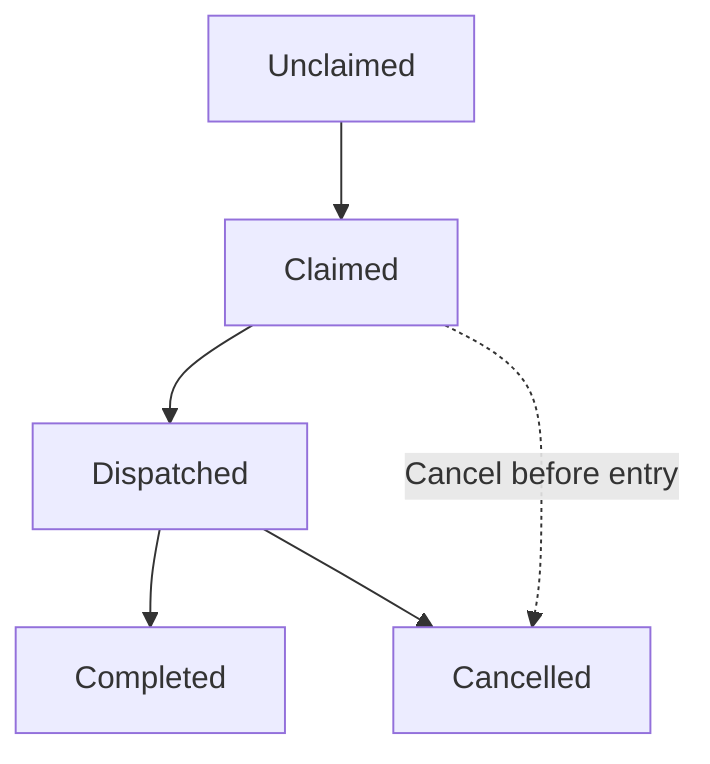
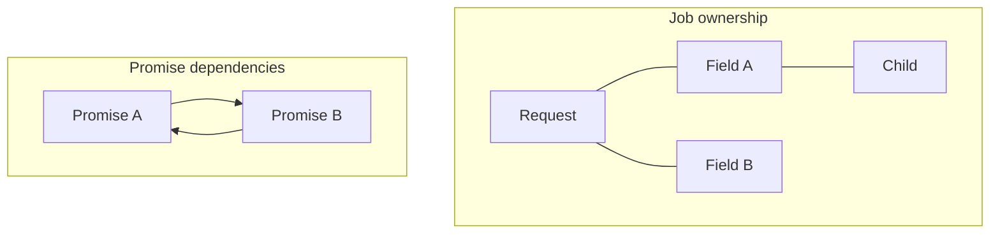
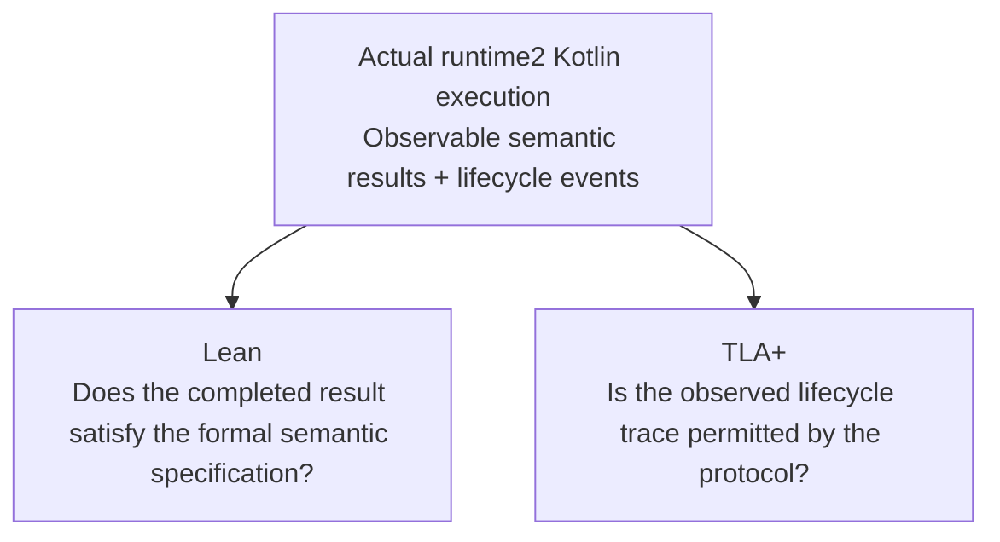

# Initial TLA vs Lean

Worked for 1m 41s

I think you're drawing exactly the right boundary between Lean and TLA+, and having looked at the current [runtime2 implementation](https://github.com/airbnb/viaduct/tree/main/core/engine/runtime2?utm_source=chatgpt.com), I'm more convinced of that division than I was when we discussed qplan.

In fact, I'd go a little further:

**Use Lean to establish that runtime2 computes the right answer. Use TLA+ to establish that runtime2 can reliably finish computing that answer—or fail and cancel correctly—under every permitted coroutine interleaving.**

There is a particularly interesting connection between the two: runtime2's structured-concurrency model should provide the operational guarantees that Lean's functional correctness proofs can assume.

That suggests an integrated verification architecture rather than two independent efforts.

## 1. What I see in the current runtime2 implementation

The architecture is well suited to this separation.

The production implementation distinguishes three important layers:

| Layer                | Important concepts                                                                       | Verification approach                             |
| -------------------- | ---------------------------------------------------------------------------------------- | ------------------------------------------------- |
| Semantic model       | OERs, selections, exact symbolic keys, demand closure, projection, resolver applications | Lean                                              |
| Resolution algorithm | Orchestration, dependency construction, input materialization, publication               | Primarily Lean, with TLA+ for lifecycle protocols |
| Coroutine execution  | Task ownership, jobs, promises, cancellation, failure isolation, nested execution        | TLA+ / TLC                                        |

One especially useful feature is that runtime2 already has an executable semantic model, rather than merely an informal GraphQL specification.

Also, the current implementation has very explicit concurrency contracts in [resolution.md](https://github.com/airbnb/viaduct/blob/main/core/engine/runtime2/impldocs/architecture/resolution.md?utm_source=chatgpt.com). The document describes root-task ownership restrictions, task-local auxiliary work, cancellation cleanup, promise completion, failure isolation, and mutation sequencing.

Those are unusually good foundations for formal modeling.

And the implementation itself contains a telling example:

```kotlin
val completion = Job(requestScope.coroutineContext[Job])
val resolutionScope = CoroutineScope(requestScope.coroutineContext + completion)
```

In `startResolution`, the new job becomes the owner of resolution work. Later, `completion.complete()` closes it to new children while permitting existing children to finish.

That's a very natural TLA+ state machine.

Meanwhile, `startResolution` returns a root result whose keys are already installed and frozen, but whose cell promises may still be pending.

That distinction—**structurally constructed versus asynchronously resolved**—is precisely the kind of distinction I would want to preserve in both verification models.

## 2. Lean: prove the semantic implementation correct

I would make Lean the primary home of the mathematical correctness specification, including the meaning of `correctResolution`.

But I'd distinguish two goals that are easy to conflate:

1. **Algorithm correctness:** A mathematically defined version of runtime2 implements the intended semantics.
2. **Implementation correctness:** The actual Kotlin functions implement that mathematically defined algorithm.

Lean makes the first very approachable relative to TLAPS. It does not automatically give you the second.

For instance, I'd define the semantic relationship:

```text
CorrectResolution(W, S, R)
```

where W is a valid resolver world, S is a selection forest, and R is a result.

Then establish a theorem of roughly this form:

```text
∀W, S,    Valid(W, S) ⇒ CorrectResolution(W, S, Resolve(W, S))
```

The theorem needs to state the result assumptions explicitly: finite demand, resolver termination, well-founded dependencies, and any restrictions on resolver behavior.

What I'd particularly like about Lean is the ability to represent runtime2's structures directly, with inductive data types, rather than encoding them as opaque finite carriers.

Consider several properties:

| Runtime2 property                                                | Lean proof technique                       |
| ---------------------------------------------------------------- | ------------------------------------------ |
| Flattened selections preserve resolution obligations             | Structural induction                       |
| Demand closure contains exactly required dependencies            | Least-fixed-point theorem                  |
| Symbolic-key identity preserves resolver occurrence distinctions | Algebraic equality / equivalence relations |
| Selection projection preserves observations                      | Induction over selections and values       |
| Result construction satisfies `correctResolution`                | Compositional correctness                  |
| Dependency ordering is valid and terminates                      | Well-founded recursion                     |
| Multiple construction orders produce equivalent results          | Confluence / permutation invariance        |

One caveat: that last theorem requires the intended independence assumptions. External resolvers can have observable side effects; runtime2 cannot generally promise that changing evaluation order preserves every externally visible effect.

### I'd use the maintained resolver families as proof scaffolding

The current README identifies Resolver06–08 and Resolver21–23 as maintained references, not obsolete snapshots. That's useful.

You could formalize the semantic algorithm represented by the simpler family first, then show that production `Resolution` preserves the same semantics despite its more sophisticated execution model.

That seems more manageable than formalizing all of production `Resolution` immediately.

However, I'd avoid investing in proofs about every historical implementation detail. Make **the semantic model the authority**, and the reference resolvers stepping stones toward production refinement.

## 3. TLA+: model the actual coroutine ownership protocol

This is where I think your proposal becomes especially valuable.

The current implementation has several features that are not merely ordinary Kotlin structured concurrency. They are runtime2-specific protocols layered on top of it.

For example, in `FieldResolverTask.kt`, a publication claims the value promise and registers its writer before dispatch:

```kotlin
publicationCell.value.claim()
operation.cycleChecker.registerWriter(...)
operation.dispatcher.dispatchFieldResolver(...)
```

Dispatch then launches the field task and installs an `invokeOnCompletion` callback that cancels its promises if the task's job completes through cancellation.

This is doing something important: it covers **cancellation before the coroutine body ever starts**.

Ordinary structured concurrency guarantees that children are attached to their parent job, but it doesn't automatically guarantee that every application-level promise *reserved before launch* gets completed or cancelled.

That's a runtime2 responsibility.

And it is a particularly good TLA+ target.

### A minimal field-task state machine

I'd model a publication initially using states like:



Terminal state also settles owned promises

Conceptual model, not a literal description of every Kotlin job state. Cancellation can race with dispatch and task execution.

I'd make **job lifecycle** and **promise lifecycle separate state variables**, rather than use the same state for both. That's essential because cancellation of the job and cancellation of its published promises happen at different points.

Then check safety properties such as:

**Every claimed publication has exactly one owner.**

```text
∀p,    Claimed(p) ⇒ ∃!t : Owns(t, p)
```

**No promise is successfully published twice.**

**Once an owner reaches cancelled completion, its owned pending publication promises are cancelled.** This is a terminal-state guarantee; cancellation in progress is a distinct condition.

**A successful request cannot finish while a required promise remains pending.**

**Cancelling a parent terminates its descendants without cancelling unrelated sibling scopes.**

**Nested `ctx.query()` work cannot outlive its invoking field task.**

The last two are the properties I'd most want to verify around structured concurrency.

### The most interesting race

Take this sequence:

1. An orchestration synchronously reserves a field cell.
2. The field task is dispatched.
3. Parent cancellation occurs before the field task starts.
4. The task body never executes.
5. The job's completion handler must terminate the reserved value, checker, and provider-binding promises.

That's exactly the sort of five-step interleaving TLC can enumerate, together with dozens of variations that nobody thinks to include in a conventional unit test.

The implementation clearly knows about this race. A TLA+ model could establish that the cleanup protocol is sufficient, under explicit assumptions about Kotlin's job-completion callbacks.

## 4. Don't overlook the inclusion-condition evaluator

The current `InclusionConditionActivation.kt` uses a `supervisorScope`, starts separate evaluations, collects completions through a channel, propagates results through a DAG, and cancels/awaits outstanding evaluations when it has enough information.

This is another particularly strong TLA+ candidate.

It has both safety and progress subtleties:

- A true disjunct may permit early success despite another branch still running.
- A failed branch may matter or not matter depending on the rest of the condition.
- An unresolved branch must not prevent a logically decisive result unnecessarily.
- Cancelling and awaiting children must not strand the parent.
- Fatal child failures must reach the owning computation.
- Different completion orders must not change the prescribed result.

This also provides a nice example of **Lean and TLA+ proving different things about the same component**.

Lean could prove:

> Given a fully determined set of leaf outcomes, the condition evaluator produces the specified Boolean/error decision according to runtime2's precedence rules.

TLA+ could prove:

> Regardless of the order in which leaf evaluations complete, the incremental evaluator reaches the corresponding decision, cancels unnecessary work, and doesn't lose any required completion signal.

This is probably one of the best places to pilot both approaches together.

## 5. The most difficult TLA+ topic: progress and deadlock

There's an important subtlety here.

Runtime2 deliberately permits user resolvers to suspend indefinitely. Consequently, the property:

> Every request eventually terminates.

is false by design.

Your testing strategy explicitly acknowledges this: slow or hanging tenant code can legitimately prevent completion.

So I would distinguish three properties:

**Safety:** Nothing bad ever happens, regardless of whether the request terminates.

**Conditional liveness:** Assuming external resolvers eventually return and the scheduler is fair, all engine-owned work eventually completes.

**Deadlock freedom:** If an operation cannot progress because of a circular dependency among engine-owned promises, that condition is detected or otherwise handled according to the specified timeout policy.

The third requires special care because your current `resolveWithTimeout` intentionally defers cycle diagnosis until a deadline. An actual cycle need not be rejected immediately.

I would therefore model the wait-for graph separately from task ownership:



Conceptual distinction: job parentage governs cancellation, while promise dependencies govern dataflow and possible deadlock.

These graphs interact but are fundamentally different.

A system can have perfectly structured concurrency and still deadlock because two sibling tasks await one another's promises.

Conversely, it can have an acyclic promise dependency graph and still strand a promise because the owning coroutine was cancelled before executing its publication code.

I would make this separation explicit in TLA+.

## 6. The missing third piece: checking the Kotlin implementation

This is the biggest qualification I'd attach to your plan.

**Proving a Lean model correct and model-checking a TLA+ concurrency protocol does not prove that runtime2's Kotlin code implements either model.**

You can close that gap incrementally without attempting full Kotlin/JVM verification.

I'd introduce a common, carefully designed abstract execution trace. Each relevant runtime2 execution would be able to record events such as:

```text
CreateTask(task, parent)
ClaimPromise(task, promise)
LaunchTask(task)
StartTask(task)
AwaitPromise(task, promise)
CompletePromise(task, promise, value)
CancelTask(task, cause)
CancelPromise(task, promise)
FinishTask(task)
FinishRequest(request)
```

Then use the two verification models differently.



For TLA+ you could use TLC to generate counterexample schedules, then turn those schedules into deterministic Kotlin tests using injected synchronization points. Separately, a trace validator could reject actual executions whose event sequences are not permitted by the model.

For Lean, you could compare the executable formal semantics against the Kotlin semantic functions on generated inputs, or serialize Kotlin's inputs/results to a checker that validates their formal relationships.

Neither constitutes a universal Kotlin refinement proof, but both provide meaningful evidence that the *actual implementation* tracks the verified abstractions.

Importantly, you already have much of the testing machinery to support this: generated worlds, correctness oracles, exact-witness tests, cross-family contracts and stress tests.

I'd extend those, not invent another independent test framework.

## 7. Where I would begin

I would avoid a grand attempt to formalize runtime2 in its entirety. I'd start with two bounded pilots whose outcomes would tell us whether this approach is productive.

| Priority | Formalization                                   | Success criterion                                                                                                                            |
| -------- | ----------------------------------------------- | -------------------------------------------------------------------------------------------------------------------------------------------- |
| 1        | TLA+: publication ownership and cancellation    | TLC finds no stranded promises across all modeled task-start/cancel/completion interleavings; injected tests exercise the critical schedules |
| 2        | Lean: selections, demand closure and projection | Unbounded structural theorems establishing correct selection and materialization behavior                                                    |
| 3        | TLA+: nested execution                          | Prove child jobs cannot outlive their owning field task and cannot terminate unrelated siblings                                              |
| 4        | TLA+: inclusion activation                      | Verify early return, error precedence, cancellation and fairness under asynchronous leaf completion                                          |
| 5        | Lean: full `CorrectResolution`                  | Compose structural theorems into correctness of the mathematical resolution algorithm                                                        |
| 6        | Cross-model correspondence                      | Check that real Kotlin outputs and lifecycle traces conform to the verified models                                                           |

One implementation detail I'd explicitly investigate during the first pilot is the trust boundary around `Job.invokeOnCompletion`. The model needs to distinguish cancellation requested, task body terminated, completion handler run, and all owned promises settled. Otherwise it would be too easy to accidentally *assume* exactly the cleanup property you intend to verify.

Similarly, `runBlocking`, `coroutineScope`, `supervisorScope`, and regular versus supervisor `Job` parentage deserve distinct semantics. Treating them all as generic parent-child tasks would conceal important failure-propagation differences.

### One practical concern: model fidelity

TLA+ does not know Kotlin's actual coroutine semantics. I'd explicitly model the small set of guarantees you rely upon as environmental assumptions, then test those assumptions independently against kotlinx.coroutines.

For instance, you would want to know whether the model correctly represents completion handlers installed on jobs cancelled before dispatch, and whether a launched task with `CoroutineStart.UNDISPATCHED` can perform synchronous work before the dispatch method returns.

Both details are relevant to the current code.

## My overall assessment

I'd adopt your proposed division, with one refinement:

**Lean owns semantic correctness. TLA+ owns concurrency protocol correctness. The Kotlin test harness owns the evidence that the implementation conforms to both.**

I would also give Lean priority over TLAPS for any new proofs about demand closure, exact occurrence identity, projection and result semantics. The existing TLA+ project can serve as reference material, but I wouldn't make its existing abstraction scheme a constraint on the new work.

And I'd prioritize TLA+ work before attempting the complete Lean proof, because the coroutine code presents a particularly immediate opportunity: a reasonably small state-machine model may find subtle bugs in job cancellation and promise lifecycle that would otherwise be very hard to reproduce.

The one especially attractive result would be to establish this contract:

> **If runtime2's semantic construction algorithm is correct (Lean), and all its required resolvers return according to their contracts, then every fair, uncancelled execution of its scheduling protocol (TLA+) produces the correct result and reaches quiescence. If execution is cancelled, every engine-owned pending publication is terminated according to its cancellation contract.**

That's not a theorem you can claim yet, and making it compositional will require work. But it gives the formal-methods project a precise destination: not merely proving interesting isolated lemmas, but eventually proving that runtime2's semantics and concurrency implementation fit together.

And that's a genuinely worthwhile level of rigor for an engine whose central business is orchestrating other people's code.

If you want, I can:

- Detail a TLA+ model for runtime2's coroutine lifecycle and cancellation race
- Outline a Lean proof sketch for runtime2 demand closure and projection correctness
- Suggest a Kotlin runtime2 trace event design for cross-model verification

