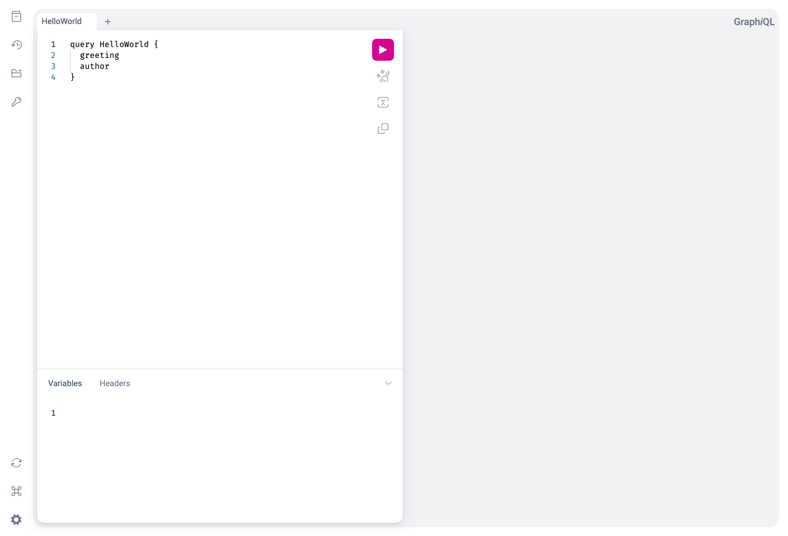
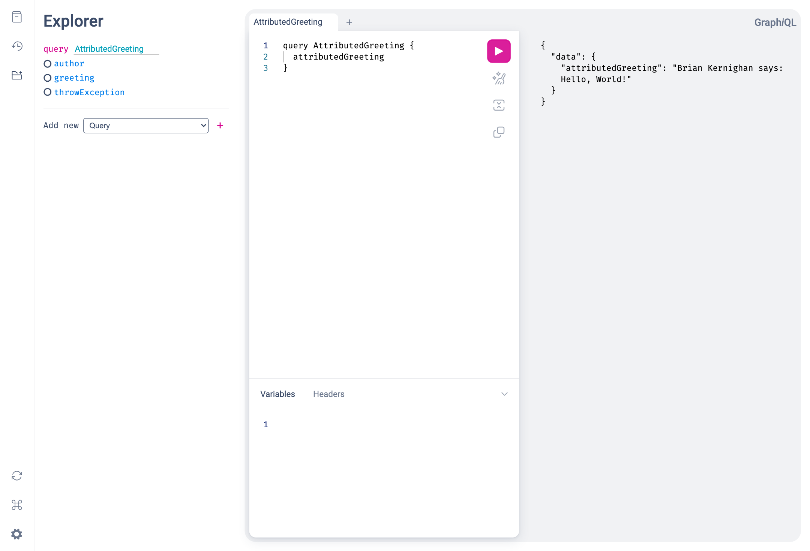

Viaduct is built for teams that want GraphQL to feel easy on day one and solid on day one hundred. This quickstart gets you from `git clone` to a running GraphQL service fast, then shows you the two parts that matter most: writing a resolver and understanding how the service is wired.

Choose **Kotlin** or **Java** below. Your selection applies to the examples throughout this page and is remembered as you browse the documentation.

## Launch Viaduct

=== "Kotlin"

    The fastest way to try Viaduct is the standalone [`ktor-starter`](https://github.com/viaduct-dev/ktor-starter). It gives you a small Ktor service with Viaduct already embedded, a GraphQL endpoint, and a built-in GraphiQL UI.

    Before you start, make sure you have:

    - Java JDK 17 or newer
    - Git
    - Linux, Mac, or Windows

    Then clone the starter:

    ```shell
    git clone https://github.com/viaduct-dev/ktor-starter.git
    ```

    Start the service:

    ```shell
    cd ktor-starter
    ```

    ```shell
    ./gradlew run
    ```

    Open <!-- djlint:off -->[http://localhost:8080/graphiql](http://localhost:8080/graphiql)<!-- djlint:on --> in your browser.

    You will land in a GraphiQL workspace with a starter query ready to run:

    

    Press the play button and you'll see the result:

    ```json
    {
      "data": {
        "greeting": "Hello, World!",
        "author": "Brian Kernighan"
      }
    }
    ```

    At this point you have a complete Viaduct service running locally: Ktor is serving HTTP, Viaduct is planning and executing GraphQL operations, and tenant resolvers are producing the response.

=== "Java"

    The Java example is [`starwars-java`](https://github.com/airbnb/viaduct/tree/master/demoapps/starwars-java), a Micronaut service with Java resolvers, a GraphQL endpoint, and a built-in GraphiQL UI.

    Before you start, make sure you have:

    - Java JDK 21 or newer, with `JAVA_HOME` pointing to that installation
    - Git
    - Linux, Mac, or Windows (use Git Bash for the commands below on Windows)

    Clone the public Viaduct repository, which contains the Java example:

    ```shell
    git clone --depth 1 https://github.com/airbnb/viaduct.git
    cd viaduct/demoapps/starwars-java
    ```

    The Java API is in Beta. This example currently uses a snapshot version of Viaduct, so enable the snapshot repository when running Gradle:

    ```shell
    USE_VIADUCT_SNAPSHOT_REPO=true ./gradlew run
    ```

    Wait for the server to start, then open <!-- djlint:off -->[http://localhost:8080/graphiql](http://localhost:8080/graphiql)<!-- djlint:on --> in your browser. Keep the server running while you use GraphiQL.

    Replace the query in the editor with:

    ```graphql
    query {
      allCharacters(limit: 1) {
        name
        displayName
      }
    }
    ```

    Press the play button and you'll see the result:

    ```json
    {
      "data": {
        "allCharacters": [
          {
            "name": "Luke Skywalker",
            "displayName": "Luke Skywalker"
          }
        ]
      }
    }
    ```

    At this point you have a complete Viaduct service running locally: Micronaut is serving HTTP, Viaduct is planning and executing GraphQL operations, and Java tenant resolvers are producing the response.

## Understanding the Application

Now that we have a working service, let's look at how it is structured: where the schema lives, where the resolvers live, and where to make your first change.

### Project structure

=== "Kotlin"

    The starter is split into a small web server and a tenant module:

    ```text
    ktor-starter/
    ├── build.gradle.kts
    ├── settings.gradle.kts
    ├── src/main/kotlin/com/example/viadapp/  -- web server
    │   ├── Routing.kt
    │   └── ViaductService.kt
    └── resolvers/                            -- tenant module
        ├── build.gradle.kts
        └── src/main/
            ├── viaduct/schema/schema.graphqls
            └── kotlin/com/example/viadapp/resolvers/
                └── HelloWorldResolvers.kt
    ```

    The root project hosts the web server. The `resolvers` project contains our tenant module, which contains the actual application code: the GraphQL schema and the Kotlin code that implements it. We'll look more deeply at the tenant module in this section, and at the web server in the next.

=== "Java"

    The example is split into a web server, two tenant modules, and a shared library:

    ```text
    starwars-java/
    ├── build.gradle.kts
    ├── settings.gradle.kts
    ├── src/main/
    │   ├── java/com/example/starwars/service/  -- web server
    │   │   ├── Application.java
    │   │   └── viaduct/
    │   │       ├── ViaductConfiguration.java
    │   │       └── ViaductRestController.java
    │   └── viaduct/scopes.yaml
    ├── common/                                -- shared application code
    └── modules/
        ├── filmography/                        -- tenant module
        │   ├── build.gradle.kts
        │   └── src/main/
        │       ├── viaduct/schema/Character.graphqls
        │       └── java/com/example/starwars/modules/filmography/
        │           └── characters/resolvers/CharacterDisplayNameResolver.java
        └── universe/                           -- tenant module
    ```

    The root project hosts the web server. The `filmography` and `universe` projects contain tenant modules: the GraphQL schema and the Java code that implements it. We'll use `filmography` for our first change.

### The schema

=== "Kotlin"

    The schema lives in `resolvers/src/main/viaduct/schema/schema.graphqls`:

    ```graphql
    extend type Query {
      greeting: String @resolver
      author: String @resolver
    }
    ```

    The `@resolver` directive tells Viaduct that each of these fields is implemented by application code. In practice, that means Viaduct generates base classes from the schema and expects you to provide Kotlin resolvers that fill in the values.

=== "Java"

    The character schema lives in `modules/filmography/src/main/viaduct/schema/Character.graphqls`. It contains these fields, among others:

    ```graphql
    type Character implements Node @scope(to: ["default"]) @resolver(isBatching: true) {
      id: ID!
      name: String
      displayName: String @resolver
    }
    ```

    The `@resolver` directive on `displayName` tells Viaduct that this field is implemented by application code. Viaduct generates a base class from the schema and expects you to provide a Java resolver that fills in the value. The other fields are populated by the character's node resolver.

### The resolvers

=== "Kotlin"

    The starter resolvers live in `resolvers/src/main/kotlin/com/example/viadapp/resolvers/HelloWorldResolvers.kt`:

    ```kotlin
    @Resolver
    class GreetingResolver : QueryResolvers.Greeting() {
        override suspend fun resolve(ctx: Context) = "Hello, World!"
    }

    @Resolver
    class AuthorResolver : QueryResolvers.Author() {
        override suspend fun resolve(ctx: Context) = "Brian Kernighan"
    }
    ```

    There are two important things happening here:

    - Each resolver extends a generated base class such as `QueryResolvers.Greeting()`.
    - Each resolver is annotated with `@Resolver` and overrides `resolve()` to produce the field value.

    This is the core Viaduct developer loop: define fields in the schema, implement them in Kotlin, then browse the result through GraphQL.

=== "Java"

    The display-name resolver lives in `modules/filmography/src/main/java/com/example/starwars/modules/filmography/characters/resolvers/CharacterDisplayNameResolver.java`:

    ```java
    package com.example.starwars.modules.filmography.characters.resolvers;

    @Resolver(objectValueFragment = "name")
    @Prototype
    public final class CharacterDisplayNameResolver extends CharacterResolvers.DisplayName {
      @Override
      public CompletableFuture<String> resolve(Context context) {
        return CompletableFuture.completedFuture(context.getObjectValue().getName());
      }
    }
    ```

    There are three important things happening here:

    - The resolver extends a generated base class, `CharacterResolvers.DisplayName`.
    - `@Resolver(objectValueFragment = "name")` declares that the resolver needs the character's `name`. Viaduct resolves that field before calling `resolve()`.
    - `resolve()` returns a `CompletableFuture<String>`. This resolver already has the value, so it returns a completed future. For an asynchronous backend call, return the future from that call or compose it with `thenApply()` or `thenCompose()`.

    `@Prototype` registers the class with Micronaut, which creates the resolver instances for this application. Viaduct's annotation comes from `viaduct.java.api.annotations.Resolver`.

    This is the core Viaduct developer loop: define fields in the schema, implement them in Java, then browse the result through GraphQL.

### Writing a Resolver

=== "Kotlin"

    Let's add a new field so you can experience that workflow end to end.

    First, extend the schema in `resolvers/src/main/viaduct/schema/schema.graphqls`:

    ```graphql
    extend type Query {
      attributedGreeting: String @resolver
    }
    ```

    Next, add a new resolver to `resolvers/src/main/kotlin/com/example/viadapp/resolvers/HelloWorldResolvers.kt`:

    ```kotlin
    @Resolver("""
      greeting
      author
    """)
    class AttributedGreetingResolver : QueryResolvers.AttributedGreeting() {
        override suspend fun resolve(ctx: Context): String {
            val greeting = ctx.getObjectValue().getGreetingOrThrow()
            val author = ctx.getObjectValue().getAuthorOrThrow()
            return "$author says: $greeting"
        }
    }
    ```

    The parameter provided to the `@Resolver` annotation is a central Viaduct feature. It declares that this resolver depends on the existing `greeting` and `author` fields. Given this annotation, Viaduct will make those values available through `ctx.getObjectValue()` before your resolver runs.

    After making these changes, stop the running server and then rebuild and run:

    ```shell
    ./gradlew run
    ```

    Back in GraphiQL, run:

    ```graphql
    query AttributedGreeting {
      attributedGreeting
    }
    ```

    You will see the new field come to life immediately:

    

    That small developer loop captures the core Viaduct experience: describe the field in schema, implement the resolver in Kotlin, and browse the result in a live GraphQL service.

=== "Java"

    Let's add a new field so you can experience that workflow end to end.

    First, add a field to the existing `Character` type in `modules/filmography/src/main/viaduct/schema/Character.graphqls`:

    ```graphql
    welcomeMessage: String @resolver
    ```

    Next, create `modules/filmography/src/main/java/com/example/starwars/modules/filmography/characters/resolvers/CharacterWelcomeMessageResolver.java`:

    ```java
    package com.example.starwars.modules.filmography.characters.resolvers;

    @Resolver(objectValueFragment = "name")
    @Prototype
    public final class CharacterWelcomeMessageResolver extends CharacterResolvers.WelcomeMessage {
      @Override
      public CompletableFuture<String> resolve(Context context) {
        String name = context.getObjectValue().getName();
        String message = "May the Force be with you, " + (name == null ? "traveler" : name) + "!";
        return CompletableFuture.completedFuture(message);
      }
    }
    ```

    The `objectValueFragment` parameter is a central Viaduct feature. It declares that this resolver depends on the character's `name` field. Viaduct makes that value available through `context.getObjectValue()` before the resolver runs. Because `name` is nullable in the schema, the resolver supplies a fallback for characters without a name.

    After making these changes, stop the running server with `Ctrl+C`, then rebuild and run from `demoapps/starwars-java`:

    ```shell
    USE_VIADUCT_SNAPSHOT_REPO=true ./gradlew run
    ```

    The build generates `CharacterResolvers.WelcomeMessage` from the new schema field before compiling your Java class. You do not write that base class yourself. If your editor initially marks it as missing, let the build finish and reload the Gradle project.

    Back in GraphiQL, run:

    ```graphql
    query WelcomeCharacter {
      allCharacters(limit: 1) {
        welcomeMessage
      }
    }
    ```

    You will see the new field come to life immediately:

    ```json
    {
      "data": {
        "allCharacters": [
          {
            "welcomeMessage": "May the Force be with you, Luke Skywalker!"
          }
        ]
      }
    }
    ```

    That small developer loop captures the core Viaduct experience: describe the field in schema, implement the resolver in Java, and browse the result in a live GraphQL service.

## Understanding the Service

If you are evaluating Viaduct for real adoption, the next question is usually not just "can I write a resolver?" but "how hard is this to fit into my stack?" Let's use the example application to explore this question.

### The web server

=== "Kotlin"

    The `ktor-starter` project illustrates how Viaduct might fit into a Ktor-based serving stack. Other Viaduct demo apps illustrate Viaduct integrating into other serving stacks, but the pattern across all stacks is similar to what we see here with Ktor.

    `src/main/kotlin/com/example/viadapp/ViaductService.kt` is the Ktor entry point: it contains the server's `main` function and configures `io.ktor.server.application.Application`.

    An application declares which scoped schemas it serves in `src/main/viaduct/scopes.yaml`. The build
    validates these against the `@scope` directives in your schema and packages them beside it, so the
    running service selects from what the build already checked:

    ```yaml
    version: 1

    schemaScopes:
      - default

    scopedSchemas:
      - id: publicSchema
        scopes: [default]
    ```

    `Routing.kt` contains the GraphQL and GraphiQL routes, and reads that declaration by id:

    ```kotlin
    private val defaultSchema = SchemaScopeInfo.fromResources(setOf(SCHEMA_ID)).single()

    // Create and initialize the [Viaduct] instance used to execute GraphQL operations
    private val viaduct by lazy {
        BasicViaductFactory.create(
            scopedSchemas = listOf(defaultSchema),
        )
    }

    fun Application.configureRouting() {
        routing {
            route("/graphql") {
                post { // Extract GraphQL operation from HTTP request and pass to Viaduct for execution
                    val request = call.receive<Map<String, Any?>>() as Map<String, Any>

                    val query = request["query"] as? String
                    if (query == null) {
                        call.respond(
                            HttpStatusCode.BadRequest,
                            mapOf("errors" to listOf(mapOf("message" to "Query parameter is required and must be a string")))
                        )
                        return@post
                    }

                    val executionInput = ExecutionInput.create(
                        operationText = query,
                        variables = (request["variables"] as? Map<String, Any>) ?: emptyMap(),
                    )

                    val result = viaduct.execute(executionInput)
                    call.respond(result.toSpecification())
                }
            }

            get("/graphiql") {
                call.respondText(graphiQLHtml(ktorStarterGraphiQLConfig), ContentType.Text.Html)
            }

            ...other GraphiQL-related routes
        }
    }
    ```

    The `Viaduct` instance is the web server's entry point into the Viaduct GraphQL engine: the web server translates its HTTP inputs into a Viaduct `ExecutionInput`, executes that operation, and returns the result (`result.toSpecification` translates the more structured execution result returned by the Viaduct engine into GraphQL-spec-compliant JSON).

=== "Java"

    The `starwars-java` project illustrates how Viaduct fits into a Micronaut serving stack. `src/main/java/com/example/starwars/service/Application.java` is the server's entry point.

    The application declares which scoped schemas it serves in `src/main/viaduct/scopes.yaml`:

    ```yaml
    version: 1

    schemaScopes:
      - default
      - extras

    scopedSchemas:
      - id: publicSchema
        scopes: [default]
      - id: publicSchemaWithExtras
        scopes: [default, extras]
    ```

    `ViaductConfiguration.java` creates the `Viaduct` instance from those declarations and supplies the factory that creates resolver instances through Micronaut:

    ```java
    @Bean
    public Viaduct providesViaduct() {
      return BasicViaductFactory.create(tenantModuleInjectorFactory, SchemaScopeInfo.fromResources());
    }
    ```

    `ViaductRestController.java` handles requests to `/graphql`. It builds an `ExecutionInput` from the HTTP request, chooses a schema based on the request's scopes, and executes the operation:

    ```java
    return viaduct
        .executeAsync(executionInput, determineSchemaId(parseScopes(scopesHeader)))
        .thenApply(result -> HttpResponse.ok(result.toSpecification()));
    ```

    `executeAsync()` returns a `CompletableFuture<ExecutionResult>`. The controller transforms that result into GraphQL JSON with `thenApply()`, allowing Micronaut to send the response when the future completes.

    `GraphiQLController.java` serves the browser interface at `/graphiql`. The HTTP server and GraphiQL interface are application code; `Viaduct` is the engine they call to execute GraphQL operations.

<a name=plugins-intro>
### The Gradle wiring

=== "Kotlin"

    Viaduct has two Gradle plugins that orchestrate schema validation, code generation, and application packaging:

    * `com.airbnb.viaduct.application-gradle-plugin` - this plugin is applied to the project that will build the `Viaduct` instance using the `BasicViaductFactory` (or the more full-featured `ViaductBuilder`). This is typically the project that contains the host web server, although it need not be.

    * `com.airbnb.viaduct.module-gradle-plugin` - this plugin is applied to the projects that contain schema fragments and the corresponding resolvers. Projects applying this plugin must be declared in the Viaduct topology in `settings.gradle.kts`; module projects must be either the same as the application project or descendants of it.

    The Viaduct topology in `settings.gradle.kts` declares the application project, its modules, and the package layout used by generated resolver code:

    ```kotlin
    plugins {
        id("com.airbnb.viaduct.settings-gradle-plugin")
    }

    includeViaductApplication {
        project(":")
        modulePackagePrefix("com.example.viadapp")

        includeModule {
            project(":resolvers")
            modulePackageSuffix("resolvers")
        }
    }
    ```

    In our Ktor application, the root Gradle project applies the application plugin and contains the Ktor server:

    ```kotlin
    plugins {
        alias(libs.plugins.kotlinJvm)
        alias(libs.plugins.ktor)
        alias(libs.plugins.viaduct.application) // Marks this project as the "root" of a Viaduct application
    }

    application {
        mainClass.set("com.example.viadapp.ViaductServiceKt")
    }

    dependencies {
        // Viaduct framework
        implementation(libs.viaduct.api)
        implementation(libs.viaduct.runtime)

        implementation(libs.ktor.server.core.jvm)
        ...other ktor dependencies
    }
    ```

    The `resolvers` subproject applies the module plugin:

    ```kotlin
    plugins {
        `java-library`
        alias(libs.plugins.kotlinJvm)
        alias(libs.plugins.ksp)
        alias(libs.plugins.viaduct.module) // Marks this project as a tenant module
    }

    dependencies {
        api(libs.viaduct.api)
        implementation(libs.viaduct.runtime)
    }
    ```

    This example has just one tenant module, but your Viaduct application can have multiple tenant modules, allowing different teams to own different parts of the overall Viaduct schema. The host service, in the meantime, handles the concerns that usually matter to platform-minded teams: web framework integration, runtime configuration, dependency injection, observability, and deployment.

=== "Java"

    Viaduct uses Gradle plugins to orchestrate schema validation, code generation, and application packaging:

    * `com.airbnb.viaduct.application-gradle-plugin` is applied to the root project that creates the `Viaduct` instance and hosts the web server.
    * `com.airbnb.viaduct.module-java-gradle-plugin` is applied to each project containing Java resolvers and their schema. It generates Java types and resolver base classes and wires annotation processing for Viaduct's module configuration.

    The build scripts use Gradle's Kotlin DSL (`.gradle.kts`), while the application and resolvers are written in Java.

    The Viaduct topology in `settings.gradle.kts` declares the application, its modules, and the package layout used by generated resolver code:

    ```kotlin
    plugins {
        id("com.airbnb.viaduct.settings-gradle-plugin")
    }

    includeViaductApplication {
        project(":")
        modulePackagePrefix("com.example.starwars")

        includeModule {
            project(":modules:filmography")
            modulePackageSuffix("filmography")
        }
        includeModule {
            project(":modules:universe")
            modulePackageSuffix("universe")
        }
    }
    ```

    The root `build.gradle.kts` applies the application and Micronaut plugins:

    ```kotlin
    plugins {
        `java-library`
        alias(libs.plugins.micronautApplication)
        alias(libs.plugins.viaduct.application)
        jacoco
    }
    ```

    Its Viaduct dependencies include the shared service API, the Java tenant runtime, and the main runtime:

    ```kotlin
    implementation(libs.viaduct.api)
    implementation(libs.viaduct.javaapi.runtime)
    implementation(libs.viaduct.runtime)
    ```

    The `modules/filmography/build.gradle.kts` file applies the Java module plugin:

    ```kotlin
    plugins {
        `java-library`
        alias(libs.plugins.viaduct.module.java)
    }

    dependencies {
        api(libs.viaduct.javaapi.api)

        implementation(project(":common"))
        implementation(libs.micronaut.inject)
        annotationProcessor(libs.micronaut.inject.java)
    }
    ```

    The Micronaut annotation processor registers the resolver classes with dependency injection. The Java module plugin handles Viaduct's generated types and module configuration.

    This example has two tenant modules. Each owns part of the schema and its Java resolvers; the host service brings them together and handles HTTP, runtime configuration, and dependency injection.

## What's Next

- Want to go deeper on resolver patterns, generated code, and schema features? Head to [Developers](../docs/developers/index.md).
- Want to understand runtime configuration, multi-tenancy, and operating Viaduct in a real service? Head to [Service Engineers](../docs/service_engineers/index.md).
- Want to keep experimenting? Replace the demo fields with a real backend call and keep using GraphiQL as your feedback loop.
